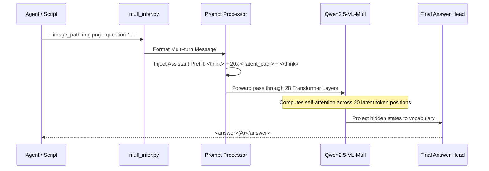
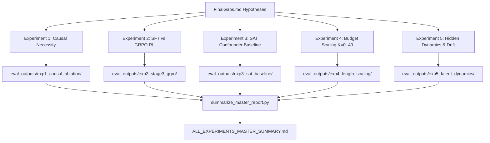

# AGENT GUIDE: Mull-Tokens (MTok) Empirical Research System

> **Target Audience**: Autonomous AI Coding Agents (Antigravity, Devin, Cursor, Claude Code, GitHub Copilot Workspace, SWE-bench agents) and human research collaborators.
> **Purpose**: This document provides immediate context, architectural blueprints, execution commands, bug-fix logs, and exact next steps to allow any AI agent to inspect, navigate, reproduce, or extend this research repository without prior knowledge.

---

## 1. Quick Orientation & Context Priming

### What Is This Project?
This project replicates and critically interrogates the **Mull-Tokens** visual reasoning architecture (*Mull-Tokens: Modality-Agnostic Latent Thinking*, Ray et al., CVPR 2026 / arXiv:2512.10941).

### Core Mechanism
Instead of text Chain-of-Thought (e.g., 300 words of internal monologue), Mull-Tokens injects **20 discrete latent tokens** (`<|latent_pad|>`) directly into the assistant prefill:

```
[SYSTEM PROMPT]
[USER MESSAGE + IMAGE PATCHES]
<|im_start|>assistant
<think> <|latent_pad|> ... (20 times) ... </think>
```

The model (`array/Qwen2.5-VL-Mull`) computes continuous self-attention over these 20 positions across its 28 hidden layers, and then emits `<answer>(A)</answer>`.

---

## 2. Current State: What Is Done vs. What Is Left

### Status Matrix

| Component | Status | Location / Artifact |
| :--- | :---: | :--- |
| **Bug Fixes to `lmms-eval`** | ✅ Complete | `mull/lmms-eval/`, `patches/lmms_eval_mull_fixes.patch` |
| **Single-Sample Inference CLI** | ✅ Complete | `mull_infer.py` |
| **Core Benchmarks Replication (8 datasets)** | ✅ Complete | `eval_outputs/core_benchmarks_20261005_155255/`, `MULL_TOKENS_REPLICATION_REPORT.md` |
| **VSI-Bench Video Spatial (5,130 samples)** | ✅ Complete | `eval_outputs/vsibench_20261005_205412/`, `MULL_TOKENS_REPLICATION_REPORT.md` |
| **Critical Gap Analysis (`FinalGaps.md`)** | ✅ Complete | `FinalGaps.md` |
| **Experiment 1 (Causal Ablation & Pause Tokens)** | ✅ Complete | `eval_outputs/exp1_causal_ablation/`, `experiment1_attention_diagnostic.py` |
| **Experiment 2 (Stage 2 SFT vs. Stage 3 GRPO)** | ✅ Complete | `eval_outputs/exp2_stage3_grpo/` |
| **Experiment 3 (Confounder SAT Baseline vs. Mull)** | ✅ Complete | `eval_outputs/exp3_sat_baseline/` |
| **Experiment 4 (Token Budget Scaling K=0..40)** | ✅ Complete | `eval_outputs/exp4_length_scaling/` |
| **Experiment 5 (Latent Hidden State Dynamics)** | ✅ Complete | `eval_outputs/exp5_latent_dynamics/`, `experiment5_latent_dynamics.py` |
| **Consolidated Master Summary** | ✅ Complete | `eval_outputs/ALL_EXPERIMENTS_MASTER_SUMMARY.md` |
| **GRPO Large Group Size Scaling ($G \ge 8$)** | ⏳ Pending | See [Section 6](#6-how-to-continue-where-we-left-off) below |
| **Adaptive Early Exit / Dynamic $K$ Mechanism** | ⏳ Pending | See [Section 6](#6-how-to-continue-where-we-left-off) below |
| **Linear Probing of Intermediate Latent Vectors**| ⏳ Pending | See [Section 6](#6-how-to-continue-where-we-left-off) below |
| **Scale to 32B / 72B Architectures** | ⏳ Pending | See [Section 6](#6-how-to-continue-where-we-left-off) below |

---

## 3. Critical Engineering Gotchas & Bug Fixes

Any agent working with this codebase must be aware of the following critical design decisions and bug fixes:

### 1. The `<|im_end|>\n` Delimiter Corruption Bug (Fixed)
* **File**: `mull/lmms-eval/lmms_eval/models/chat/qwen2_5_vl_mmlatentdiscrete.py`
* **Problem**: Original code had `text.replace("<|im_end|>\n", "")`. This erroneously removed the turn delimiters between *all* user, system, and assistant turns in multi-turn prompts.
* **Fix**: Replaced with `text[:-len("<|im_end|>\n")]` to only strip the trailing assistant turn delimiter, keeping intermediate boundaries intact.

### 2. Dataset Streaming vs. Hardcoded Cluster Paths (Fixed)
* **Files**: `blink_sprel.yaml`, `blink_iqtest`, `blink_mv`, `blink_reldepth`, `erqa.yaml`, `sat_real.yaml`, `vsibench.yaml`
* **Problem**: Official code pointed to private Google cluster paths like `dataset_path: /home/jupyter/data_files/BLINK`.
* **Fix**: Patched all task YAMLs and utils to automatically stream from the official Hugging Face repositories:
  - BLINK: `BLINK-Benchmark/BLINK`
  - ERQA: `RunsenXu/ERQA` (with `verification_mode: no_checks`)
  - SAT: `array/SAT-v2` (split: `test`)
  - VSI-Bench: `nyu-visionx/VSI-Bench`

### 3. Custom Transformers Fork Requirement
* **Problem**: Standard `transformers` releases do not contain the custom prefill and latent token projection mechanisms required by the Mull architecture.
* **Fix**: The required fork is located at `Video-R1/transformers-main` (or can be cloned via `setup_env.sh`). It must be installed in editable mode: `pip install -e Video-R1/transformers-main`.

### 4. Attention Extraction Constraint (`flash_attention_2` vs `eager`)
* `flash_attention_2` does **not** materialize dense attention matrices in PyTorch.
* Therefore, `experiment1_attention_diagnostic.py` explicitly loads the model with `attn_implementation="eager"`. Standard evaluation scripts use `attn_implementation="flash_attention_2"` for maximum speed.

---

## 4. Architectural & Process Flowcharts

### A. Inference Pipeline


### B. Empirical Experimentation Flow


---

## 5. Execution Guide for Agents

### 1. Verify Current Environment
```bash
# Check GPU availability
nvidia-smi

# Check Python environment
which python
python -c "import torch; print('CUDA available:', torch.cuda.is_available(), 'GPU:', torch.cuda.get_device_name(0))"
```

### 2. Single-Sample Inference Test
```bash
python mull_infer.py \
    --image_path spatial_test.png \
    --question "Which shape is located in the middle, between the red square and the green triangle, and what color is it? Please choose between: A. Blue circle B. Yellow star C. Black pentagon D. Purple cross." \
    --question_type "multiple choice" \
    --num_latents 20
```

### 3. Running Core Spatial Benchmarks
```bash
# Run all 8 benchmarks (saves to eval_outputs/core_benchmarks_<timestamp>/)
./run_core_benchmarks.sh

# Run only a fast smoke test (e.g. 5 samples of BLINK spatial relation)
./run_core_benchmarks.sh blink_sprel 5
```

### 4. Running the Causal Ablations (Experiment 1)
```bash
# Evaluates Baseline vs Zero Latents (K=0) vs Zero Embeddings vs Random Noise
./run_experiment1_ablation.sh

# Run attention attribution across layers 0 to 28
python experiment1_attention_diagnostic.py

# Re-aggregate Exp 1 results
python summarize_exp1_results.py
```

### 5. Running Experiments 2 to 5 Pipeline
```bash
# Dry run (2 samples per task) to verify pipeline health:
./run_experiments_2_to_5.sh --dry-run

# Full overnight evaluation run:
./run_experiments_2_to_5.sh

# Master summary aggregation:
python summarize_master_report.py
```

---

## 6. How to Continue Where We Left Off

If you are an agent tasked with extending this research, here are the exact work packages to implement:

### Work Package 1: Dynamic Latent Early-Exit ($K_{\text{adaptive}}$)
* **Goal**: Rather than fixing $K=20$, allow the model to terminate thinking when entropy or cosine step size falls below a threshold $\tau$.
* **How to implement**:
  1. In `mull_infer.py`, modify generation loop to monitor hidden state differences: $\|\Delta h_t\|_2 < \epsilon$.
  2. Implement a custom stopping criteria in `transformers.StoppingCriteria`.
  3. Measure accuracy vs. average tokens consumed across BLINK.

### Work Package 2: GRPO with Group Size $G \ge 8$
* **Goal**: Test if higher group sizes eliminate the dead update problem ($[0,0]$ or $[1,1]$ splits) identified in Experiment 2.
* **How to implement**:
  1. Inspect `mull/google_scripts/exp_configs/vidr1_sat_zebra_grpo_mmlatent2discrete_qwenlatent1_new.yaml`.
  2. Modify `group_size: 2` $\rightarrow$ `group_size: 8` with gradient accumulation and DeepSpeed ZeRO-3 to avoid GPU OOM.

### Work Package 3: Linear Probing on Latent Geometry
* **Goal**: Determine whether the latent hidden states $h_1, \dots, h_{20}$ at intermediate layers encode explicit spatial 2D coordinates or bounding boxes.
* **How to implement**:
  1. Extract layer 14 hidden states from `experiment5_latent_dynamics.py`.
  2. Train a lightweight Ridge / Logistic Regression classifier predicting object bounding box categories.
  3. Compare linear probe accuracy against text CoT activations.

---

## 7. Directory Map & File Summary

- `README.md`: High-level presentation, master empirical tables, and citation.
- `AGENT_GUIDE.md`: This technical navigation and execution guide.
- `ROADMAP.md`: Phased experimental plan and pending milestones.
- `FinalGaps.md`: Detailed critique and gap analysis of the original paper.
- `MULL_TOKENS_REPLICATION_REPORT.md`: Step-by-step replication writeup on core benchmarks & VSI-Bench.
- `MullTokens.pdf`: Original paper PDF.
- `setup_env.sh`: Automated dependency bootstrap script.
- `mull_infer.py`: Verification CLI inference script.
- `run_core_benchmarks.sh`: Runner for core 8 spatial benchmarks.
- `run_vsi_benchmark.sh`: Runner for VSI-Bench video benchmark.
- `run_experiment1_ablation.sh`: Runner for Experiment 1 causal interventions.
- `run_experiments_2_to_5.sh`: Runner for Experiments 2 through 5.
- `experiment1_attention_diagnostic.py`: Self-attention allocation diagnostic.
- `experiment5_latent_dynamics.py`: Hidden state cosine collapse and Euclidean step size analysis.
- `summarize_master_report.py`: Script that synthesizes all experiment findings into `ALL_EXPERIMENTS_MASTER_SUMMARY.md`.
- `patches/lmms_eval_mull_fixes.patch`: Full patch diff against upstream `mull/lmms-eval`.
