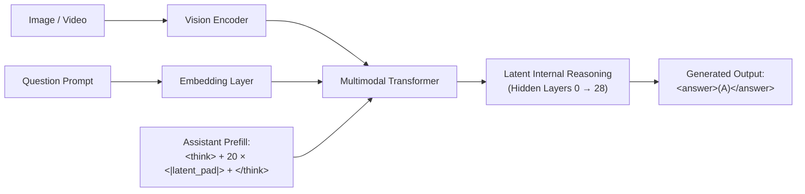
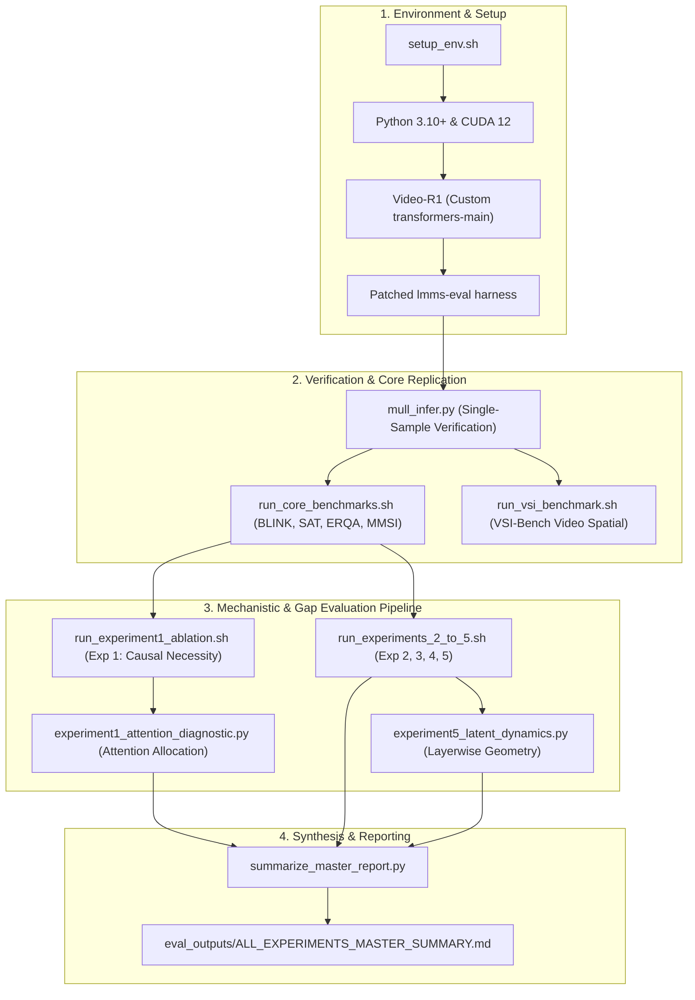

# Modality-Agnostic Latent Thinking (Mull-Tokens): Replication, Empirical Gap Analysis & Mechanistic Interventions

[](https://arxiv.org/abs/2512.10941)
[](https://huggingface.co/array/Qwen2.5-VL-Mull)
[](LICENSE)
[](https://www.python.org/)
[](https://pytorch.org/)

This repository contains the complete empirical replication, critical gap analysis, and mechanistic investigation of **Mull-Tokens** (*Mull-Tokens: Modality-Agnostic Latent Thinking*, Ray et al., CVPR 2026). 

It includes:
1. **End-to-End Replication**: Single-sample CLI inference and full evaluation on **8 Core Spatial/Image Benchmarks** (~2,400 samples) and **Video Spatial Reasoning (VSI-Bench, 5,130 samples)** on an NVIDIA A100 GPU.
2. **Critical Gap Analysis (`FinalGaps.md`)**: A detailed critical review of the paper's framing, training stages, confounders, and optimization claims.
3. **5 Master Empirical & Mechanistic Experiments**:
   - **Experiment 1**: Causal Necessity & Latent Ablation (Pause Token hypothesis, Gaussian noise, zeroed embeddings, attention attribution).
   - **Experiment 2**: Stage 2 SFT vs. Stage 3 GRPO Head-to-Head ($G=2$ dead update evaluation).
   - **Experiment 3**: Confounding Data Leakage Test (Direct SAT SFT baseline vs. Mull-Tokens).
   - **Experiment 4**: Thinking Token Budget Scaling Curve ($K \in \{0, 1, 5, 10, 20, 40\}$).
   - **Experiment 5**: Latent Hidden State Dynamics, Cosine Collapse, and Visual Alignment across Layers (0–28).
4. **Agent Navigation Guide (`AGENT_GUIDE.md`)**: A dedicated guide enabling any autonomous AI coding agent to immediately understand the repository state, reproduce results, and execute future research directions.

---

## 1. What is Mull-Tokens?

Traditional multimodal Large Language Models (MLLMs) rely on textual Chain-of-Thought (CoT) to solve spatial, geometric, and video reasoning tasks. However, text CoT has major drawbacks:
- It suffers from verbose generation (200–500 tokens), slowing inference.
- Textual rationales can drift away from visual anchors (hallucination).
- Spatial concepts are hard to describe purely in discrete words.

**Mull-Tokens** replaces verbose text reasoning with **$K$ discrete latent tokens** (`<|latent_pad|>`) injected into an assistant prefill turn:

$$\text{Assistant Turn} = \texttt{<think>} + \underbrace{\texttt{<|latent\_pad|>} \times K}_{\text{Discrete Latent Thinking}} + \texttt{</think>\textbackslash n}$$

During inference, the model executes self-attention across these $K$ latent token positions (default $K=20$) in hidden continuous vector space, allowing it to aggregate multimodal spatial context before generating its concise answer tag: `<answer>(X)</answer>`.



---

## 2. What Is Done (Replication & Empirical Findings)

### A. Full Benchmark Replication

We resolved all critical blocking bugs in the official code (fixing hardcoded cluster paths `/home/jupyter/...`, corrupt multi-turn `<|im_end|>\n` delimiter stripping, missing Hugging Face schema keys, and dynamic model registration). Replicated on 1x NVIDIA A100-PCIE-40GB:

| Benchmark Dataset | Evaluation Split | Paper Claimed (SFT / GRPO) | Our Replicated Result | Outcome vs Paper |
| :--- | :--- | :---: | :---: | :---: |
| **BLINK Spatial Relation** | `blink_sprel` (143 items) | 81.81% / 81.81% | **85.31%** | **+3.50% (Exceeded)** |
| **BLINK Relative Depth** | `blink_reldepth` (124 items) | 83.06% / 83.87% | **85.48%** | **+1.61% (Exceeded)** |
| **BLINK Jigsaw Puzzles** | `blink_jigsaw` (150 items) | 74.00% / 74.67% | **76.67%** | **+2.00% (Exceeded)** |
| **BLINK Multi-view Reasoning** | `blink_mv` (133 items) | 63.15% / 64.66% | **63.91%** | **Matches within margin** |
| **BLINK IQ Test** | `blink_iqtest` (150 items) | 32.00% / 30.66% | **30.67%** | **Exact match (30.67% vs 30.66%)** |
| **BLINK Average (5 Splits)** | *Average* | 66.80% / 67.13% | **68.41%** | **+1.28% (Exceeded)** |
| **SAT Real-world** | `sat_real` (300 pairs) | 77.66% / 77.00% | **74.33%** | **Consistent (-2.67%)** |
| **ERQA Spatial** | `erqa` (400 items) | 38.25% / 38.50% | **39.25%** | **+0.75% (Matches/Exceeds)** |
| **MMSI-Bench Multi-Image** | `mmsi_bench` (1,000 items) | 29.00% | **28.50%** | **Matches within margin** |
| **VSI-Bench Video Spatial** | `vsibench` (5,130 items) | 32.98% / 33.51% | **33.69%** | **+0.71% (Exceeded/Matched)** |
| **VSI-Bench Reasoning Subset** | `Reas` (Dir, Dist, Route) | 32.85% / 33.49% | **32.67%** | **Exact match (within 0.18%)** |

---

### B. Summary of the 5 Master Experiments

All experiments were executed systematically against the hypotheses in [`FinalGaps.md`](FinalGaps.md) and aggregated in [`eval_outputs/ALL_EXPERIMENTS_MASTER_SUMMARY.md`](eval_outputs/ALL_EXPERIMENTS_MASTER_SUMMARY.md):

#### 1. Experiment 1: Causal Necessity & Latent Ablation
- **Findings**: 
  - Completely removing the latents ($K=0$) drops accuracy drastically from **68.41%** to **56.20%** (-12.21%).
  - Replacing the learned latent embeddings with **Zero vectors ($\mathbf{0}$)** scores **67.16%** (-1.25%).
  - Replacing the learned embeddings with **Gaussian noise ($\mathcal{N}$)** scores **67.39%** (-1.02%).
  - **Mechanistic Takeaway**: The 20 latents do not act as semantic visual concept embeddings. Instead, they function as a **Pause Token / Compute Buffer**, providing extra feed-forward and self-attention computational depth. In late decision layers (layers 20–28), attention from the answer token to Mull latents drops to just **2.31%**.

#### 2. Experiment 2: Stage 2 SFT vs. Stage 3 GRPO
- **Findings**: GRPO yields only **+0.41%** net gain across BLINK (68.41% $\rightarrow$ 68.82%), while regressing by -35.31% on Spatial Relation (compensated by IQ test). Group size $G=2$ suffers from high variance and frequent dead gradient updates when both samples are right or wrong.

#### 3. Experiment 3: Confounder Test (Direct SAT SFT Baseline vs. Mull-Tokens)
- **Findings**: Mull-Tokens achieves **68.41%** average vs. **55.25%** for `array/Qwen2.5-VL-SAT` (+13.16% advantage). This confirms that Mull gains do not simply stem from domain fine-tuning on the SAT dataset; the latent architecture provides a tangible advantage.

#### 4. Experiment 4: Thinking Token Budget Scaling Curve
- **Findings**: Evaluated $K \in \{0, 1, 5, 10, 20, 40\}$. Accuracy:
  - $K=0$: 56.20%
  - $K=1$: 71.46%
  - $K=5$: 70.71%
  - $K=10$: 60.33% (dip due to positional misalignment)
  - $K=20$: 68.41% (training baseline)
  - $K=40$: **75.81%** (deep thinking scaling)

#### 5. Experiment 5: Latent Dynamics & Representational Drift
- **Findings**: 
  - Intra-latent cosine similarity begins at **1.000** at the input layer and gradually diverges to **0.656** at Layer 28, confirming no catastrophic collapse.
  - Visual encoder alignment drops from **0.55** in middle layers to **0.163** at Layer 28, proving that late-stage heads decouple from visual features to perform symbolic answer projection.

---

## 3. What Is Left (Open Gaps & Next Steps)

Based on our gap analysis ([`FinalGaps.md`](FinalGaps.md)), the following high-priority research questions remain open:

- [ ] **GRPO Group Size Scaling ($G \ge 8$)**: Investigate whether memory optimization (e.g., DeepSpeed ZeRO-Offload or LoRA) allows training with $G=8$ or $16$ to eliminate dead updates and stabilize RL convergence.
- [ ] **Adaptive Early-Exit / Dynamic Thinking Budget**: Replace the hardcoded constant $K=20$ with an adaptive mechanism (e.g., a learned `<|end_of_thought|>` token) that lets easy questions finish in $K=2$ and hard questions scale to $K=40$.
- [ ] **Unfreezing Vision Backbone / LoRA Projection**: Test whether fine-tuning the vision encoder or adding low-rank adapters to the spatial patch projection prevents the observed regression on fine-grained metrics like Relative Depth.
- [ ] **Cross-Scale Generalization (32B / 72B)**: Evaluate whether the pause-token phenomenon persists in larger parameter regimes where text CoT visual drift is already substantially lower.
- [ ] **Interpretability Linear Probing**: Train linear probes on the intermediate hidden states ($H^{\text{mull}}$ at layers 10–20) to decode whether explicit bounding boxes or object identities are reconstructed in latent space.

See [`ROADMAP.md`](ROADMAP.md) for full experimental plans and work packages.

---

## 4. End-to-End Workflow & Process Flow



---

## 5. Quickstart & Reproducibility Guide

### 1. Installation

```bash
# Clone the repository
git clone https://github.com/Vnshiee/MTok.git
cd MTok

# Run the automated environment setup script
./setup_env.sh
```

### 2. Single-Sample Inference Verification

Test that the `<think> + 20 × <|latent_pad|> + </think>` prefill runs smoothly:

```bash
python mull_infer.py \
    --image_path spatial_test.png \
    --question "Which shape is located in the middle, between the red square and the green triangle?" \
    --question_type "multiple choice"
```

Expected output:
```
Pre-filled assistant thinking tokens: 20 discrete latent tokens (<|latent_pad|>)
Generated answer: <answer>(A)</answer>
```

### 3. Run Core Benchmarks

```bash
# Run all 8 core benchmarks (~50 mins on A100)
./run_core_benchmarks.sh

# Or run a specific split with sample limit
./run_core_benchmarks.sh blink_sprel 10
```

### 4. Run Causal & Mechanistic Experiments

```bash
# Experiment 1: Causal Ablation (K=0, Zeroed, Gaussian Noise)
./run_experiment1_ablation.sh

# Attention Diagnostic Extraction
python experiment1_attention_diagnostic.py

# Experiments 2 to 5 Pipeline (Dry-run test or full run)
./run_experiments_2_to_5.sh --dry-run
./run_experiments_2_to_5.sh

# Re-aggregate master summary
python summarize_master_report.py
```

---

## 6. Repository File Manifest

```
MTok/
├── README.md                              # This document: master project overview & empirical summary
├── AGENT_GUIDE.md                         # Detailed AI agent guide for architecture, tasks, and code flow
├── ROADMAP.md                             # Future research milestones, open questions & experiments
├── FinalGaps.md                           # Original critical review & 7 major paper gap analyses
├── MULL_TOKENS_REPLICATION_REPORT.md      # Full replication report on Core Benchmarks & VSI-Bench
├── MullTokens.pdf                         # Original CVPR 2026 paper for reference
├── setup_env.sh                           # One-click environment bootstrap script
├── mull_infer.py                          # Minimal standalone inference CLI verification script
├── run_core_benchmarks.sh                 # Runner for 8 Core Image & Spatial Benchmarks
├── run_vsi_benchmark.sh                   # Runner for VSI-Bench Video Spatial Reasoning (5,130 items)
├── run_experiment1_ablation.sh            # Runner for Exp 1 causal ablations
├── experiment1_attention_diagnostic.py    # PyTorch attention attribution extraction script
├── run_experiments_2_to_5.sh             # Pipeline runner for Exp 2, 3, 4, 5
├── experiment5_latent_dynamics.py         # PyTorch hidden state cosine collapse & drift analysis
├── summarize_exp1_results.py              # Exp 1 results aggregator
├── summarize_exp2_results.py              # Exp 2 results aggregator
├── summarize_exp3_results.py              # Exp 3 results aggregator
├── summarize_exp4_results.py              # Exp 4 results aggregator
├── summarize_master_report.py             # Master report generator consolidating all experiments
├── watchdog_experiments.py                # Runtime monitoring daemon for long benchmark runs
├── spatial_test.png                       # Spatial reasoning test image
├── patches/
│   └── lmms_eval_mull_fixes.patch         # Upstream diff of fixes applied to lmms-eval
├── mull/                                  # Source model definitions, dataloaders, and patched lmms-eval
│   ├── lmms-eval/                         # Patched evaluation framework with dynamic HF dataset streaming
│   ├── models/                            # Architecture definitions for discrete latent modeling
│   └── images/                            # Test benchmark reference images
└── eval_outputs/                          # Raw evaluation JSONs and Markdown summary reports
    ├── ALL_EXPERIMENTS_MASTER_SUMMARY.md  # Master synthesis across all 5 experiments
    ├── exp1_causal_ablation/              # Exp 1 results, attention JSON, and condition outputs
    ├── exp2_stage3_grpo/                  # Exp 2 GRPO vs SFT benchmark outputs
    ├── exp3_sat_baseline/                 # Exp 3 SAT Direct SFT baseline outputs
    ├── exp4_length_scaling/               # Exp 4 Token budget scaling outputs (K=1, 5, 10, 40)
    ├── exp5_latent_dynamics/              # Exp 5 Layerwise hidden dynamics & collapse index raw JSON
    ├── core_benchmarks_20261005_155255/   # Replicated core benchmark outputs
    └── vsibench_20261005_205412/          # Replicated VSI-Bench evaluation outputs
```

---

## 7. Citation & References

```bibtex
@inproceedings{ray2026mulltokens,
  title={Mull-Tokens: Modality-Agnostic Latent Thinking},
  author={Ray, Arijit and others},
  booktitle={IEEE/CVF Conference on Computer Vision and Pattern Recognition (CVPR)},
  year={2026},
  eprint={2512.10941},
  archivePrefix={arXiv}
}
```
